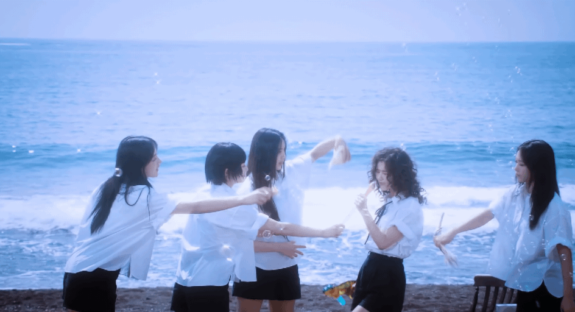

---

### 👋 About me

- 🔭 Currently building a **Household Electricity Load & Cost Calculator**
- 🌱 Learning **Flask**, **SQLite**, and data visualization with **Chart.js**
- ⚡ Interested in Networking
- 📫 Reach me: **Sanipmaul@gmail.com** 
---

  <b>NEWJEANS NEVER DIES!!!!!</b>
    
  

### 🛠️ Tech stack

---

---

### 📊 GitHub stats

  
  

---

  

